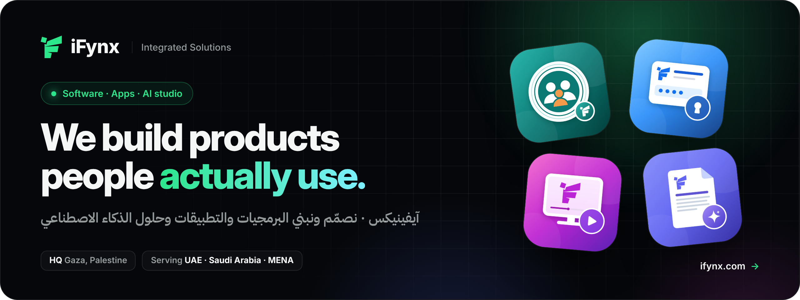
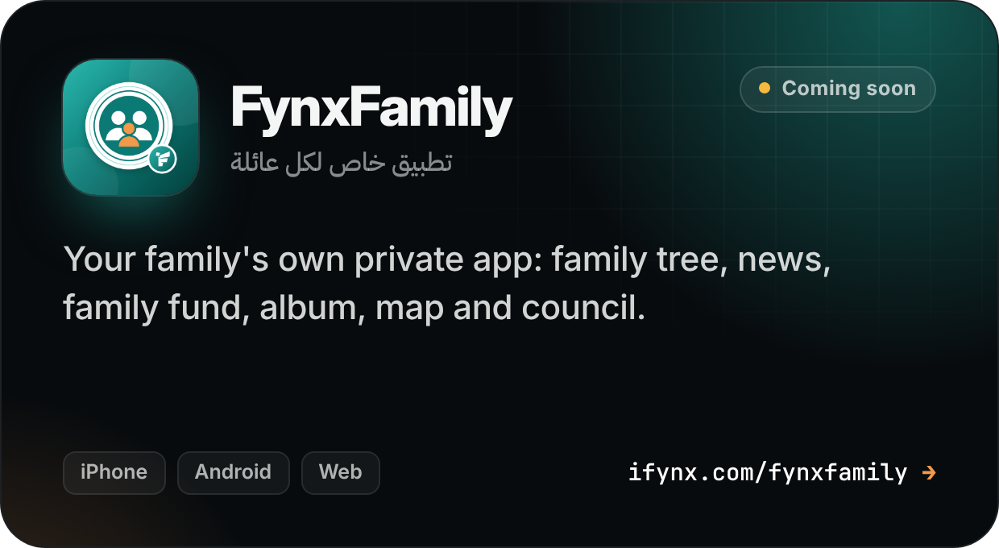
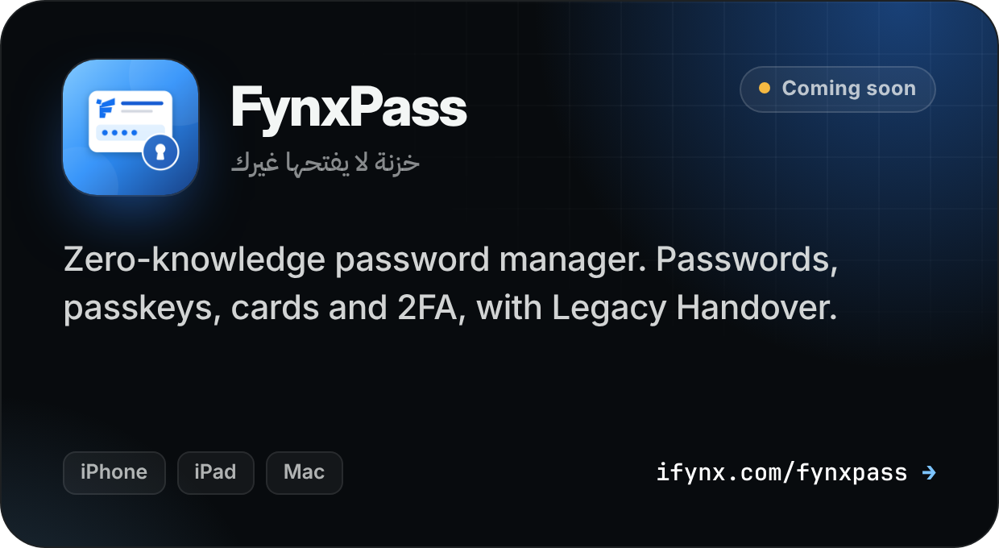
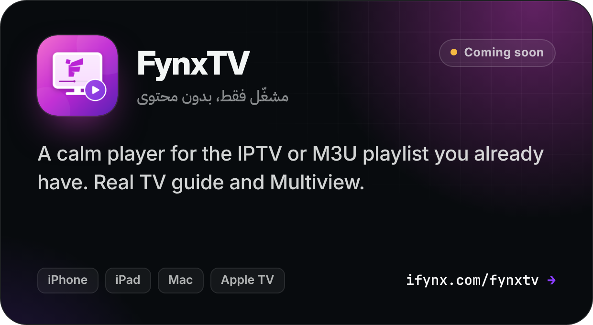
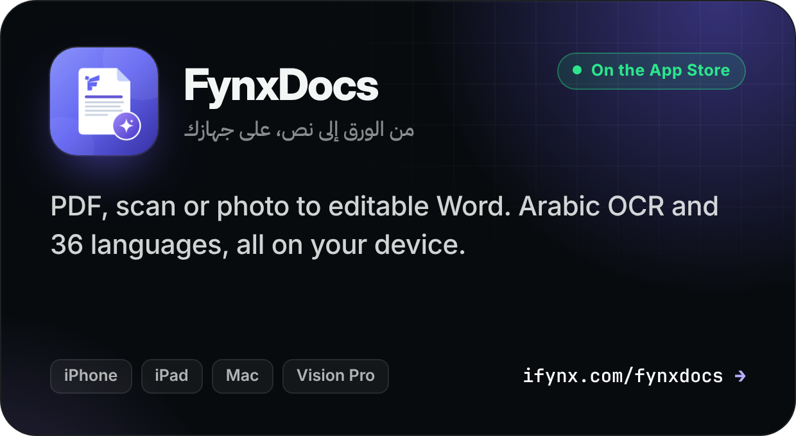
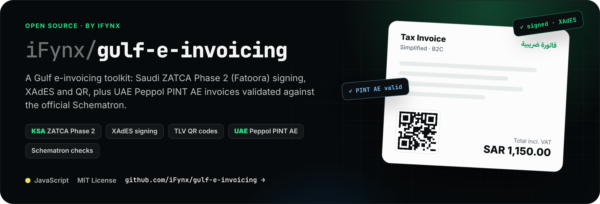
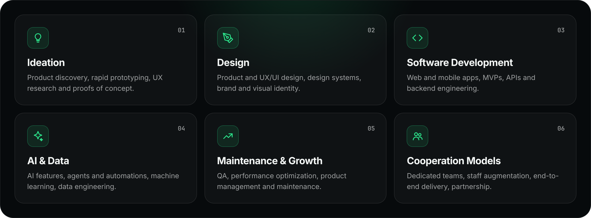
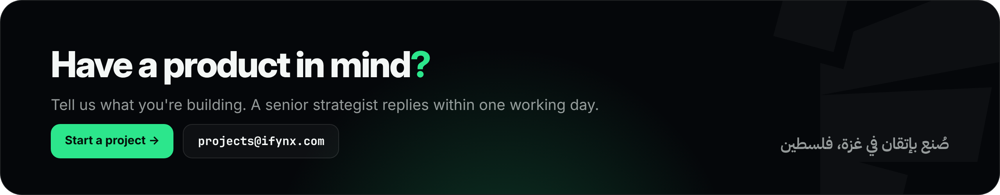

<a href="https://ifynx.com/">
  <picture>
    <source media="(prefers-color-scheme: dark)" srcset="./assets/banner-dark.png">
    <source media="(prefers-color-scheme: light)" srcset="./assets/banner-light.png">
    
  </picture>
</a>

  
  
  
  
  

 

**iFynx Integrated Solutions** is a software, app and AI development studio headquartered in **Gaza, Palestine**. We design, build and run products for companies across the **UAE, Saudi Arabia and MENA**, and we ship our own apps, Arabic first.

<b>آيفينيكس</b> استوديو لتطوير البرمجيات والتطبيقات وحلول الذكاء الاصطناعي، مقرّه غزة، فلسطين. نعمل مع الشركات في الإمارات والسعودية والمنطقة، ونبني منتجاتنا الخاصة بالعربية أولاً.

 

## Our products

  
  

  
  

## Open source

## What we do

<a href="https://ifynx.com/services/">
  <picture>
    <source media="(prefers-color-scheme: dark)" srcset="./assets/services-dark.png">
    <source media="(prefers-color-scheme: light)" srcset="./assets/services-light.png">
    
  </picture>
</a>

  

<a href="https://ifynx.com/contact/">
  <picture>
    <source media="(prefers-color-scheme: dark)" srcset="./assets/footer-dark.png">
    <source media="(prefers-color-scheme: light)" srcset="./assets/footer-light.png">
    
  </picture>
</a>

iFynx Integrated Solutions P.S.C. · Gaza, Palestine · <a href="https://ifynx.com/">ifynx.com</a> · <a href="https://ifynx.com/ar/">العربية</a>

